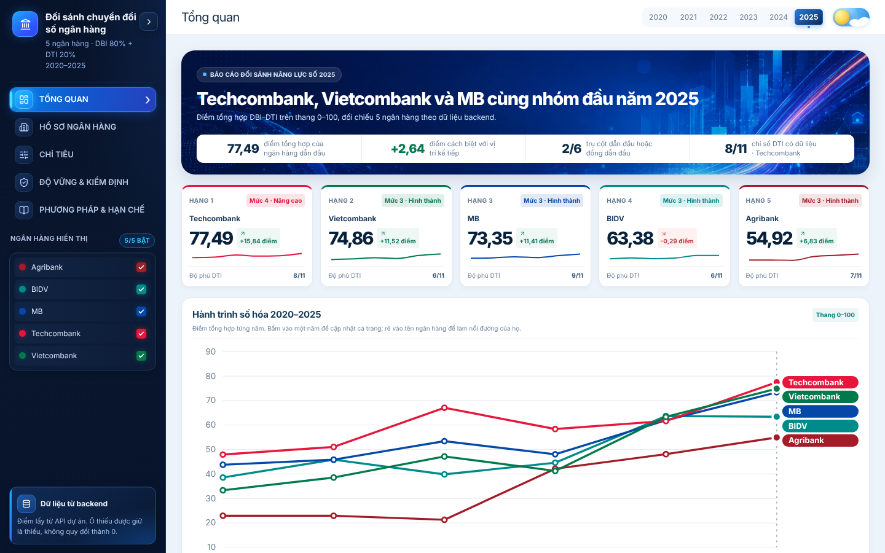
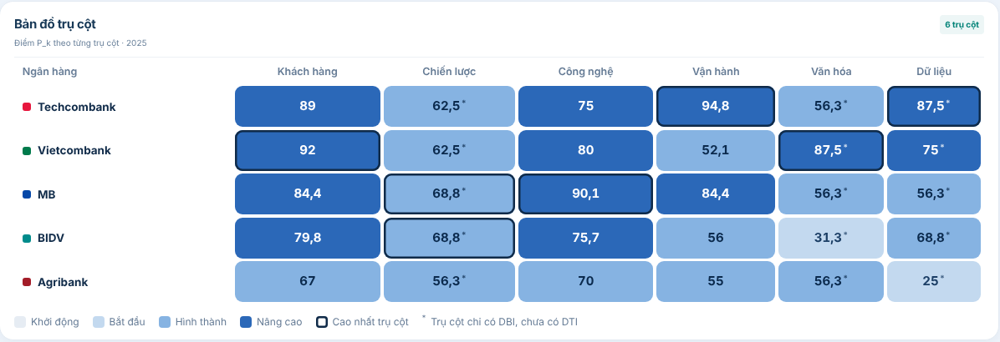
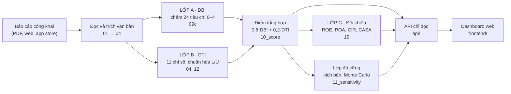

<div align="center">

# Bank DX Toolkit

### Đo, so sánh và kiểm chứng mức chuyển đổi số của 5 ngân hàng Việt Nam bằng dữ liệu công khai

**5 ngân hàng · 2020–2025 · 6 trụ cột · 24 tiêu chí · 11 chỉ số định lượng · 3 lớp kiểm chứng**

[Xem dashboard](https://frontend-ashy-kappa-57.vercel.app/) · [API tương tác](https://bank-dx-toolkit.onrender.com/docs) · [Phương pháp](specs/001-bank-dx-assessment/algorithm-scoring.md) · [Hướng dẫn chạy](#5-hướng-dẫn-sử-dụng)



</div>

---

## 1. Dự án này làm gì

Các bảng xếp hạng "ngân hàng số" thường dựa vào khảo sát hoặc nhận định cảm tính, khó biết điểm từ đâu ra và không ai kiểm lại được.

**Bank DX Toolkit** làm theo cách ngược lại. Công cụ đọc báo cáo công khai của Agribank, BIDV, Vietcombank, MB và Techcombank (báo cáo thường niên, báo cáo tài chính kiểm toán, điểm ứng dụng trên cửa hàng ứng dụng), chấm điểm theo một khung cố định, rồi cho bạn thấy ba điều:

1. **Điểm bao nhiêu** — mỗi ngân hàng, mỗi năm, từng trụ cột.
2. **Điểm đó dựa vào đâu** — bấm vào là thấy tệp, số trang và đoạn trích gốc.
3. **Có nên tin điểm đó không** — thứ hạng nào vững, thứ hạng nào chỉ là nhiễu, và dữ liệu nào còn thiếu.

Sản phẩm gồm: bộ script thu thập và chấm điểm, API chỉ đọc, và dashboard web 5 màn hình. Dự án phục vụ một đề tài nghiên cứu học thuật và chỉ dùng tài liệu công khai.

### Điểm nhấn

| | |
|---|---|
| **Truy vết đến từng trang PDF** | Mỗi điểm gắn với tệp nguồn, số trang, đoạn trích, phiên bản quy tắc và mã băm. Không có điểm nào "tự nhiên có". |
| **Thiếu dữ liệu không bị đổi thành 0** | Ô trống là ô trống. Tiêu chí "không tìm thấy từ khóa" khác với "ngân hàng không làm". Độ phủ dữ liệu luôn hiển thị cạnh điểm. |
| **Cận chuẩn hóa khóa trước và có nhật ký** | Cận L/U của 11 chỉ số được ghi kèm nguồn và lý do. Lần đổi gần nhất (v2) được ghi rõ là đổi sau khi thấy dữ liệu, bản v1 vẫn giữ để đối chiếu. |
| **Ba lớp kiểm chứng độc lập** | Lớp A chấm văn bản, lớp B tính chỉ số định lượng, lớp C đối chiếu với kết quả kinh doanh thật. Thêm một lớp thử độ vững của thứ hạng. |
| **Nói thẳng khi hai ngân hàng chưa tách được** | Trên dashboard, ngân hàng cách nhau dưới 3 điểm được xếp cùng nhóm, thay vì ép ra hạng 1, 2, 3. Ngưỡng 3 điểm là quy ước hiển thị. |
| **Tái lập được** | Cùng đầu vào cho cùng đầu ra. Manifest ghi mã băm của code, từ khóa và dữ liệu. |

---

## 2. Kết quả nhanh

### Năm 2025

| Ngân hàng | Điểm tổng hợp | Mức | Hạng khi đổi giả định* |
|---|---:|---|---|
| Techcombank | **77,49** | 4 · Nâng cao | 1–2 |
| Vietcombank | **74,86** | 3 · Hình thành | 1–3 |
| MB | **73,35** | 3 · Hình thành | 1–3 |
| BIDV | **63,38** | 3 · Hình thành | 4 |
| Agribank | **54,92** | 3 · Hình thành | 5 |

\* Khoảng hạng nhận được khi thử các kịch bản khác nhau (đổi trọng số, đổi cận L/U, nhiễu rubric, Monte Carlo). Chi tiết ở [mục 4.4](#44-lớp-kiểm-tra-độ-vững-của-thứ-hạng).

**Cách đọc đúng:** nhóm đầu gồm Techcombank, Vietcombank và MB (chênh nhau 4,15 điểm). BIDV và Agribank tách rõ khỏi nhóm đầu và khỏi nhau. Không nên kết luận "Techcombank hơn Vietcombank" chỉ từ 2,6 điểm chênh lệch.

### Hành trình 2020–2025

| Ngân hàng | 2020 | 2021 | 2022 | 2023 | 2024 | 2025 |
|---|---:|---:|---:|---:|---:|---:|
| Techcombank | 47,9 | 51,0 | 67,1 | 58,4 | 61,7 | 77,5 |
| Vietcombank | 33,3 | 38,5 | 47,1 | 41,2 | 63,3 | 74,9 |
| MB | 43,8 | 45,8 | 53,4 | 48,0 | 61,9 | 73,3 |
| BIDV | 38,5 | 45,8 | 39,9 | 44,6 | 63,7 | 63,4 |
| Agribank | 22,9 | 22,9 | 21,2 | 42,1 | 48,1 | 54,9 |

**Lưu ý khi so sánh giữa các năm:** số trụ cột có chỉ số DTI thay đổi theo năm (hiện là 0 trụ cột năm 2020–2021, 1 trụ cột năm 2022–2024, 3 trụ cột năm 2025), nên điểm các năm không hoàn toàn cùng cơ sở. Năm 2024 bốn ngân hàng đầu chỉ cách nhau khoảng 2 điểm và được gộp thành một nhóm.

<div align="center">

</div>

---

## 3. Mô hình hoạt động

### 3.1. Công thức

```
Điểm trụ cột  P_k  =  0,8 × DBI_k  +  0,2 × DTI_k        (trụ cột không có DTI thì P_k = DBI_k)
Điểm ngân hàng     =  trung bình của 6 điểm P_k            (thang 0–100)
```

- **DBI** (Digital Business Index, 80%) đo *ngân hàng nói và làm gì* về chuyển đổi số, chấm từ văn bản báo cáo.
- **DTI** (Digital Transformation Indicators, 20%) đo *các con số* như tỷ lệ giao dịch qua kênh số, CIR, điểm ứng dụng.
- Khung DBI dựa trên Quyết định 2158/QĐ-BTTTT (07/11/2023), DTI bổ trợ.

### 3.2. Sáu trụ cột

| Trụ cột | 4 tiêu chí DBI | Chỉ số DTI |
|---|---|---|
| **K** · Khách hàng | Phủ sóng kênh số · Định danh và xác thực điện tử · Cá nhân hóa · Đo lường trải nghiệm | K-Q1, K-Q2, K-Q3 |
| **S** · Chiến lược | Chiến lược chuyển đổi số · Quản trị · Cam kết nguồn lực · Hợp tác hệ sinh thái và fintech | S-Q1, S-Q2 |
| **T** · Công nghệ | Hạ tầng và kiến trúc · An toàn thông tin · Open API · Công nghệ mới ở mức use-case | T-Q1, T-Q2 |
| **O** · Vận hành | Tự động hóa quy trình · Số hóa tín dụng và hậu trường · Quản trị rủi ro số · Vận hành linh hoạt | O-Q1, O-Q2 |
| **C** · Văn hóa | Thông điệp lãnh đạo · Đào tạo kỹ năng số · Văn hóa đổi mới · Môi trường làm việc số | C-Q1, C-Q2 |
| **D** · Dữ liệu | Quản trị dữ liệu · Hạ tầng dữ liệu · Phân tích nâng cao và AI/ML · Bảo vệ dữ liệu cá nhân | *(không có, P_D = DBI_D)* |

### 3.3. Năm mức trưởng thành

| Mức | Tên | Điểm |
|:-:|---|---|
| 1 | Khởi động | dưới 25 |
| 2 | Bắt đầu | 25 đến dưới 50 |
| 3 | Hình thành | 50 đến dưới 75 |
| 4 | Nâng cao | 75 đến dưới 100 |
| 5 | Dẫn dắt | đúng 100 |

---

## 4. Bóc tách từng lớp



| Lớp | Câu hỏi nó trả lời | Dữ liệu vào | Script | Kết quả chính |
|---|---|---|---|---|
| **A · DBI** | Báo cáo nói và làm gì về chuyển đổi số? | Văn bản BCTN, BCTC, BCPTBV | `09c_auto_score.py` | `output_data/auto_scores.csv`, `output_data/coding_auto.xlsx` |
| **B · DTI** | Các con số nói gì? | BCTC, KPI trong BCTN, rating app, kiểm kê nền tảng | `04`, `05`, `12`, `10_score.py` | `output_data/dti_indicators.csv`, `output_data/scores.csv` |
| **C · Đối chiếu** | Điểm có đi cùng kết quả kinh doanh không? | ROE, ROA, CIR, CASA, thu nhập ngoài lãi | `19_validate_layer_c.py` | `api/static/v1/layer-c/`, `output_data/layer_c_*.csv` |
| **Độ vững** | Thứ hạng có đổi khi đổi giả định không? | Điểm A + B | `11_sensitivity.py` | `output_data/sensitivity/` |

### 4.1. Lớp A: DBI, chấm văn bản bằng quy tắc

**Ý tưởng.** Với mỗi tiêu chí, thuật toán tìm từ khóa (song ngữ Việt và Anh) trong báo cáo, mở cửa sổ ±300 ký tự quanh đó và hỏi: có động từ hành động không? có con số kèm đơn vị không? có dấu hiệu kiểm chứng, đa kỳ hay KPI không?

| Kết quả | Điểm | Ý nghĩa |
|---|:-:|---|
| `no_document` | để trống | Không có văn bản đọc được. Không suy ra 0. |
| `no_mention` | 0 | Có văn bản nhưng không tìm thấy từ khóa. Không chứng minh ngân hàng không làm. |
| `scored` | 1 | Có nhắc đến nhưng chưa bắt được hành động thực hiện. |
| `scored` | 2 | Có hành động thực hiện (loại câu tương lai và phủ định). |
| `scored` | 3 | Hành động cộng con số kèm đơn vị trong cùng cửa sổ. |
| `scored` | 4 | Mức 3 cộng điều kiện riêng của tiêu chí: kiểm chứng, đa kỳ, quản trị, lộ trình, KPI hoặc chứng nhận. |

`DBI_k` là trung bình 4 tiêu chí của trụ cột đổi sang thang 0–100.

**Truy vết.** `output_data/auto_scores.csv` lưu điểm, trạng thái, tệp, trang, đoạn trích và toàn bộ bằng chứng dùng để chấm. `output_data/auto_scoring_manifest.json` lưu phiên bản và mã băm.

**Giới hạn cần biết.** Đây là phép đo *dấu hiệu trong văn bản*, chưa phải đánh giá chuyên gia. Một câu có từ khóa và con số có thể nói về chủ đề khác. Quy tắc `rule-based-v1` **chưa được kiểm chứng độc lập**: khi thử một bản quy tắc chặt hơn, thứ hạng các ngân hàng sát nhau đổi chỗ (xem [docs/dbi-rules-sensitivity.md](docs/dbi-rules-sensitivity.md)). Vì vậy dự án khuyến nghị cho 2 người đọc tay 40–60 ô điểm trước khi công bố kết luận về hạng.

### 4.2. Lớp B: DTI, 11 chỉ số định lượng

Mỗi chỉ số được chuẩn hóa về 0–100 theo công thức `z = 100 × clip((x − L) / (U − L), 0, 1)`. Chỉ số có chiều "càng thấp càng tốt" (như thay đổi CIR) được đảo dấu.

| Chỉ số | Đo gì | Chiều | Cận L–U | Loại cận |
|---|---|---|---|---|
| K-Q1 | Tỷ lệ giao dịch khách hàng qua kênh số | cao tốt | 0–90 | có nguồn |
| K-Q2 | Tỷ lệ khách hàng số / tổng khách hàng | cao tốt | 0–100 | thang tự nhiên |
| K-Q3 | Điểm ứng dụng (App Store + Google Play, gia quyền theo lượt đánh giá) | cao tốt | 1–5 | có nguồn |
| S-Q1 | Thay đổi tỷ lệ giao dịch số bình quân năm | cao tốt | 0–18 | suy ra |
| S-Q2 | Tăng trưởng kép số khách hàng số | cao tốt | 0–24,46 | tham chiếu ngoài mẫu |
| T-Q1 | Nguyên giá phần mềm / tổng tài sản bình quân | cao tốt | 0,0799–0,5657 | phân vị mẫu |
| T-Q2 | Độ phủ 8 nền tảng số (kiểm kê thủ công) | cao tốt | 0–100 | thang tự nhiên |
| O-Q1 | Thay đổi CIR bình quân năm | thấp tốt | −1,1226–1,4844 | phân vị mẫu |
| O-Q2 | Tăng trưởng kép thu nhập hoạt động trên nhân viên | cao tốt | 3,0577–9,4781 | phân vị mẫu |
| C-Q1 | Tỷ lệ nhân sự công nghệ / tổng nhân sự | cao tốt | 0–100 | thang tự nhiên |
| C-Q2 | Số giờ đào tạo bình quân mỗi nhân viên | cao tốt | 34,5–83,331 | phân vị mẫu |

Cận ở `config/dti_bounds.yaml`, phiên bản `fixed-reference-v2-2026-10-17`. Bốn chỉ số loại "phân vị mẫu" (phân vị 10% và 90% của mẫu gộp 5 ngân hàng) là thang *tương đối*, phụ thuộc mẫu. Cận được đổi sau khi đã thấy dữ liệu vì cận v1 làm điểm bão hòa; việc này được ghi ngay đầu file cấu hình, và bản v1 lưu ở `output_data/dti_bounds_review_2026-10-12/` để đối chiếu. Lý giải đầy đủ: [dti-bounds-method.md](specs/001-bank-dx-assessment/dti-bounds-method.md).

**Hai cổng bảo vệ tính công bằng:**

- **Bước 0.** Một chỉ số bị loại cho *cả 5 ngân hàng* trong năm đó nếu có từ 2 ngân hàng trở lên thiếu số liệu.
- **Bước 0b.** Một trụ cột chỉ nhận DTI trong năm đó khi *cả 5 ngân hàng* đều có ít nhất một chỉ số của trụ cột. Nếu không, mọi ngân hàng dùng DBI thuần cho trụ cột đó, để không có ngân hàng nào được chấm theo công thức khác.

Dữ liệu thiếu luôn để trống. Cột `step0b_excluded` trong `output_data/dti_indicators.csv` ghi các ô bị loại.

### 4.3. Lớp C: đối chiếu với kết quả kinh doanh

**Câu hỏi:** nếu điểm chuyển đổi số có ý nghĩa thì nó phải đi cùng một số kết quả kinh doanh. Lớp này đo *mức độ đi cùng*, không chứng minh nhân quả.

Kết quả hiện tại (hệ số tương quan hạng Spearman ρ, dùng điểm DBI, gộp các năm):

| Chỉ tiêu | Kỳ vọng | ρ gộp | Số quan sát | Nhận xét |
|---|:-:|---:|---:|---|
| CASA | + | **+0,59** | 25 | Cùng chiều kỳ vọng, mức trung bình đến khá |
| ROA | + | **+0,47** | 29 | Cùng chiều kỳ vọng |
| CIR | − | **−0,36** | 30 | Cùng chiều kỳ vọng |
| ROE | + | **−0,15** | 29 | **Không** cùng chiều kỳ vọng |

Mỗi năm chỉ có tối đa 5 điểm nên từng năm riêng lẻ rất nhiễu và p-value không đáng tin. Đọc bảng này như bằng chứng mô tả ở mức sơ bộ. Kết quả ROE không ủng hộ giả thuyết; dự án báo cáo đúng như vậy, không loại bỏ.

### 4.4. Lớp kiểm tra độ vững của thứ hạng

Chạy lại xếp hạng dưới 40 kịch bản rời rạc cộng mô phỏng Monte Carlo: đổi tỷ lệ DBI/DTI (100/0, 80/20, 70/30, 60/40), nhiễu trọng số trụ cột (Dirichlet Monte Carlo), loại từng trụ cột, dịch cận L/U, thêm nhiễu vào điểm rubric, đổi cách chuẩn hóa. Kết quả mỗi ngân hàng là khoảng hạng nhỏ nhất–lớn nhất và nhãn:

- **Vững**: hạng gần như không đổi.
- **Vững (sát ngưỡng)**: hạng đổi nhẹ ở một vài kịch bản.
- **Nhóm cùng mức**: không tách được khỏi các ngân hàng cạnh nhau, năm 2024 bốn ngân hàng đầu nằm ở trạng thái này (hạng 1–4).

Chi tiết: [docs/sensitivity.md](docs/sensitivity.md).

---

## 5. Hướng dẫn sử dụng

Chọn mức phù hợp với việc bạn cần làm.

| Bạn muốn | Làm mức | Cần cài |
|---|---|---|
| Xem kết quả | [A](#mức-a-xem-dashboard-không-cần-cài-gì) | Chỉ trình duyệt |
| Chạy dashboard trên máy mình | [B](#mức-b-chạy-dashboard-trên-máy-của-bạn) | Python, Node.js |
| Tính lại điểm từ dữ liệu đã có | [C](#mức-c-tính-lại-điểm-từ-dữ-liệu-đã-thu-thập) | Python |
| Thu thập lại từ báo cáo gốc hoặc thêm năm mới | [D](#mức-d-chạy-toàn-bộ-từ-báo-cáo-gốc) | Python, Internet |

### Mức A: xem dashboard, không cần cài gì

Mở https://frontend-ashy-kappa-57.vercel.app/. Nếu trang báo lỗi tải dữ liệu, đợi một lát rồi bấm **Thử lại** vì máy chủ API có thể đang khởi động.

| Màn hình | Dùng để |
|---|---|
| **Tổng quan** | Xem điểm từng năm, hành trình 2020–2025 (bấm một năm để cả trang đổi theo), nhóm điểm, bản đồ 6 trụ cột |
| **Hồ sơ ngân hàng** | Xem một ngân hàng: năng lực 6 trụ cột, điểm mạnh và tiêu chí cần cải thiện, bảng 24 tiêu chí kèm trích dẫn và đường dẫn nguồn, bảng chỉ số DTI |
| **Chỉ tiêu** | Xem từng tiêu chí đạt mức nào, tiêu chí khác nhau nhiều nhất và đồng đều nhất giữa các ngân hàng, 11 chỉ số DTI kèm bằng chứng |
| **Độ vững & Kiểm định** | Xem thứ hạng có ổn định không (đổi trọng số, xác suất từng hạng, các kịch bản) và tương quan với ROE, ROA, CIR, CASA, thu nhập ngoài lãi |
| **Phương pháp & Hạn chế** | Đọc công thức và những điều chưa kiểm chứng |

Mẹo: ô điểm có dấu `*` trong bản đồ trụ cột nghĩa là trụ cột đó năm đó chỉ có DBI.

### Mức B: chạy dashboard trên máy của bạn

Cần Python (khuyến nghị 3.10 trở lên) và Node.js (20.19 trở lên hoặc 22.12 trở lên). Dùng **hai cửa sổ terminal**.

**Terminal 1, backend (từ thư mục gốc của repo):**

```powershell
pip install -r requirements-api.txt
uvicorn api.main:app --reload --port 8000
```

Khi thấy `Uvicorn running on http://127.0.0.1:8000` là xong. Thử mở http://localhost:8000/docs để xem API.

**Terminal 2, frontend:**

```powershell
cd frontend
npm install
npm run dev
```

Mở địa chỉ in ra (thường là http://localhost:5173/).

Sự cố thường gặp:

| Triệu chứng | Nguyên nhân và cách xử lý |
|---|---|
| `Could not read package.json` | Đang đứng ở thư mục gốc. Chạy `cd frontend` trước. |
| `'vite' is not recognized` | Chưa chạy `npm install` trong `frontend`. |
| Trang báo "Không tải được dữ liệu từ backend" | Backend chưa chạy. Mở terminal 1. |
| Muốn trỏ frontend vào API khác | Đặt biến `VITE_API_BASE_URL`, ví dụ `https://bank-dx-toolkit.onrender.com/api/v1`. |

Không muốn chạy server? Xuất JSON tĩnh bằng `python -m api.export_static` (ghi vào `api/static/v1/`), rồi đặt lên bất kỳ máy chủ file tĩnh nào. Phải chạy lại lệnh này sau mỗi lần điểm thay đổi.

### Mức C: tính lại điểm từ dữ liệu đã thu thập

Dữ liệu đã chấm nằm sẵn trong `output_data/`, nên bạn không cần tải lại PDF.

```powershell
pip install -r requirements.txt
cd scripts
python 12_appendix.py --bundle
python 10_score.py --years 2020,2021,2022,2023,2024,2025
python 11_sensitivity.py            # tùy chọn: độ vững thứ hạng
python 19_validate_layer_c.py --years 2020,2021,2022,2023,2024,2025   # tùy chọn: lớp C
cd ..
python -m api.export_static         # cập nhật JSON tĩnh cho dashboard
```

Kết quả: `output_data/score_summary.csv` (điểm và hạng từng năm), `output_data/scores.csv` (từng trụ cột), `output_data/dti_indicators.csv` (từng chỉ số). Muốn xem bằng Excel, mở `output_data/score_results.xlsx`.

Muốn đổi một giả định rồi xem hạng đổi thế nào: `python 10_score.py --weight-scenarios` thêm các kịch bản 100/0, 80/20, 70/30, 60/40.

### Mức D: chạy toàn bộ từ báo cáo gốc

Dùng khi bạn thêm năm mới, đổi nguồn hoặc muốn tự kiểm chứng toàn bộ chuỗi. Thư mục `data/raw/`, `data/text/` không nằm trong repo (nặng, tái tạo được), nên bước này tải lại tài liệu từ `config/sources.csv`.

```powershell
cd scripts
python 01_download.py            # tải PDF, kiểm tra robots.txt, nghỉ ≥ 3 giây giữa các yêu cầu
python 02_extract_text.py        # PDF → văn bản từng trang (thêm --ocr nếu PDF là ảnh)
python 03_locate_evidence.py     # tìm đoạn chứa từ khóa của 24 tiêu chí
python 04_extract_numbers.py --bctc
python 04_extract_numbers.py --kpi
python 05_app_ratings.py --collect
python 09c_auto_score.py         # lớp A: chấm DBI
python 12_appendix.py --bundle   # đóng gói DTI đã xác nhận
python 10_score.py               # lớp B + tổng hợp
```

Điều quan trọng: **các bước 04 và 05 chỉ đưa ra ứng viên số liệu.** Người thực hiện phải mở PDF đối chiếu rồi ghi giá trị đã xác nhận vào `output_data/dti_inputs.csv` (kèm tệp, trang, định nghĩa). Chỉ số liệu đã xác nhận mới được tính điểm.

**Thêm một năm mới:** thêm năm vào `years` và `coding_years` trong `config/banks.yaml`, thêm link báo cáo vào `config/sources.csv`, rồi chạy lại các bước trên.

Hướng dẫn chi tiết từng script, cách xử lý PDF lỗi font, cách lấy từng loại số liệu và quy tắc đạo đức thu thập: [docs/pipeline-guide.md](docs/pipeline-guide.md).

### Kiểm thử

```powershell
python -m pytest tests/test_api.py -q
python tests/test_sensitivity.py
cd scripts
python ../tests/smoke_test.py
python ../tests/test_auto_score.py
python ../tests/test_regressions.py
python ../tests/test_score.py
python ../tests/test_layer_c.py
```

Kiểm thử xác nhận code chạy đúng hành vi mong đợi. Chạy đạt không thay cho việc đối chiếu dữ liệu với báo cáo thật.

### Triển khai

| Thành phần | Nơi chạy | Ghi chú |
|---|---|---|
| Dashboard (`frontend/`) | Vercel | Build bằng `npm run build`. Địa chỉ API được nhúng lúc build qua `VITE_API_BASE_URL`, nên đổi API thì phải build và deploy lại. |
| API (`api/`) | Render | Chạy bằng `uvicorn api.main:app`. Đọc thư mục `output_data/` và `config/` trong repo, nên phải đẩy dữ liệu mới lên GitHub rồi redeploy để số trên web đổi theo. |

Khi điểm thay đổi, thứ tự đúng là: chạy lại pipeline → commit `output_data/` và `api/static/` → redeploy API → build lại và deploy frontend.

---

## 6. Cấu trúc repository

```
bank-dx-toolkit/
├── config/             Cấu hình: ngân hàng, nguồn báo cáo, từ khóa 24 tiêu chí, cận L/U, rubric
├── scripts/            Pipeline 00–21, chạy từ thư mục này
├── data/               PDF và văn bản trung gian (không nằm trong repo, tái tạo bằng bước 01–02)
├── output_data/                Kết quả: điểm, bằng chứng, dữ liệu DTI đã xác nhận, độ vững
├── api/                API chỉ đọc (FastAPI) và JSON tĩnh trong api/static/v1/
├── frontend/           Dashboard React + TypeScript + Vite
├── specs/              Đặc tả, phương pháp chấm, phương pháp chọn cận L/U
├── docs/               Hướng dẫn pipeline, độ nhạy, thử nghiệm quy tắc
├── tests/              Kiểm thử
└── examples/           PDF mẫu và đầu ra mẫu của từng script
```

### Đọc kết quả ở đâu

| Bạn tìm | Mở |
|---|---|
| Điểm và hạng mỗi ngân hàng mỗi năm | `output_data/score_summary.csv` |
| Điểm 6 trụ cột | `output_data/scores.csv` |
| Từng chỉ số DTI: số thô, z, trạng thái | `output_data/dti_indicators.csv` |
| Điểm từng tiêu chí DBI và bằng chứng | `output_data/auto_scores.csv` hoặc `output_data/coding_auto.xlsx` |
| Số liệu đầu vào DTI kèm nguồn và trang | `output_data/dti_inputs.csv` |
| Ô nào bị loại bởi bước 0 và 0b | `output_data/step0_gate.csv`, cột `step0b_excluded` |
| Độ vững thứ hạng | `output_data/sensitivity/` |
| Mô tả từng cột dữ liệu sạch | `output_data/dataset_clean/DATA_DICTIONARY.md` |

---

## 7. Nguyên tắc thiết kế

1. **Chỉ dùng dữ liệu công khai.** Tôn trọng `robots.txt`, nghỉ ít nhất 3 giây giữa các yêu cầu, không đăng nhập, không lấy dữ liệu bên trong ứng dụng, không vượt paywall hay captcha.
2. **Không bao giờ điền 0 cho dữ liệu thiếu.** Ô trống là ô trống; độ phủ dữ liệu luôn đi kèm điểm.
3. **Cận chuẩn hóa không lấy theo mẫu một cách ngầm.** Cận có nguồn hoặc được ghi rõ là phân vị mẫu, có khóa phiên bản và có nhật ký thay đổi.
4. **Mọi con số truy được về nguồn.** Tệp, trang, đoạn trích.
5. **Không suy diễn quá dữ liệu.** Chỉ có 5 ngân hàng, nên mọi thống kê chỉ mang tính mô tả và không có kết luận nhân quả.

---

## 8. Hạn chế đã biết

Những điều dưới đây nên được nêu trong báo cáo nghiên cứu.

| Hạn chế | Ảnh hưởng | Hướng xử lý |
|---|---|---|
| Quy tắc chấm DBI chưa được người kiểm chứng | Hạng sát nhau (cả 2024 và ba vị trí đầu 2025) chưa đủ cơ sở | Người đọc tay 40–60 ô điểm, so với kết quả thuật toán |
| Chỉ có 5 ngân hàng | Tương quan lớp C và mọi kiểm định chỉ mang tính mô tả | Không suy diễn thống kê |
| Số trụ cột có DTI thay đổi theo năm | Điểm các năm không hoàn toàn cùng cơ sở, năm 2020–2021 gần như chỉ là DBI | Dashboard hiển thị ghi chú theo năm |
| Một số cận L/U là phân vị mẫu | Thang tương đối, phụ thuộc 5 ngân hàng này | Thêm tham chiếu ngoài mẫu khi có |
| S-Q2 và C-Q1 chỉ có rất ít quan sát; T-Q2 không phân biệt được ngân hàng | Các chỉ số này gần như không đóng góp | Thu thập thêm dữ liệu |
| Từ khóa tiếng Anh chưa thử trên nhiều báo cáo thật | Báo cáo tiếng Anh (MB, Techcombank, một số năm BIDV) có thể bị chấm thấp | Rà lại mẫu theo từng ngôn ngữ |

---

## 9. Tài liệu liên quan

| Tài liệu | Nội dung |
|---|---|
| [NOP_BAI.md](NOP_BAI.md) | Hồ sơ nộp bài: yêu cầu giảng viên đối chiếu với vị trí file trong repo, danh sách còn thiếu |
| [report/BAO_CAO_TONG_HOP.md](report/BAO_CAO_TONG_HOP.md) | Báo cáo tổng hợp (mục tiêu, mô hình, quy trình, kết quả, hạn chế) và [phụ lục PL1–PL5](report/phu_luc/) |
| [docs/pipeline-guide.md](docs/pipeline-guide.md) | Hướng dẫn chi tiết từng script, lấy từng biến ở đâu, những chỗ dễ sai, đạo đức thu thập |
| [specs/001-bank-dx-assessment/algorithm-scoring.md](specs/001-bank-dx-assessment/algorithm-scoring.md) | Phương pháp chấm DBI bằng quy tắc |
| [specs/001-bank-dx-assessment/dti-bounds-method.md](specs/001-bank-dx-assessment/dti-bounds-method.md) | Cách chọn cận L/U cho từng chỉ số |
| [specs/001-bank-dx-assessment/spec.md](specs/001-bank-dx-assessment/spec.md) | Đặc tả yêu cầu của đề tài |
| [docs/sensitivity.md](docs/sensitivity.md) | Phân tích độ nhạy, cách đọc kết quả |
| [docs/dbi-rules-sensitivity.md](docs/dbi-rules-sensitivity.md) | Thử nghiệm quy tắc chấm chặt hơn và kết quả |
| [api/README.md](api/README.md) | Danh sách endpoint và quy ước dữ liệu cho frontend |
| [output_data/dataset_clean/DATA_DICTIONARY.md](output_data/dataset_clean/DATA_DICTIONARY.md) | Từ điển dữ liệu |

Dự án dùng cho mục đích học thuật. Khi sử dụng, vui lòng trích dẫn nguồn báo cáo gốc của từng ngân hàng.
